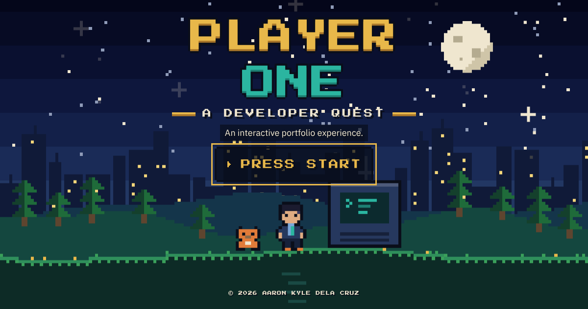

# Aaron Dela Cruz - Space Portfolio

Responsive personal portfolio built with vanilla HTML, CSS, JavaScript, GSAP, and Three.js. The site ships as static files and is ready for GitHub Pages, Netlify, Vercel, or any static host.

<<<<<<< HEAD
## What Ships
=======

>>>>>>> 42a9438064d6abbac2c9a51c85f0b3097ac71d11

- Full-screen animated space background on canvas
- Three.js OBJ satellite with responsive scroll path, auto-rotation, and drag rotation
- GSAP ScrollTrigger reveal animations and skill bars
- Responsive hero, skills, certifications, projects, contact, and poster-style footer
- Mobile navigation and touch-friendly project browsing
- Static deployment model with no build step

## Project Structure

```text
.
|-- index.html
|-- css/
|   |-- base.css       # Tokens, reset, global utilities
|   |-- space.css      # Fixed background and satellite loader styles
|   `-- sections.css   # Navbar, sections, cards, footer, responsive rules
|-- js/
|   |-- main.js        # App boot and UI systems
|   |-- animation.js   # GSAP reveals and skill bar animation
|   |-- satellite.js   # Three.js satellite model and scroll path
|   |-- space-bg.js    # Animated star/nebula canvas
|   |-- scroll.js      # Scroll progress and active section tracking
|   `-- utils.js       # Small shared helpers
|-- assets/
|   |-- satellite/
|   `-- icons/
|-- libs/              # Local GSAP, ScrollTrigger, Three.js, OBJ/MTL loaders
`-- docs/
```

## Local Development

Use a local server. ES modules and model assets should not be opened via `file://`.

```bash
npm install
npm test
npx serve .
```

Any static server works:

```bash
python -m http.server 8080
```

## Production Checklist

- Replace placeholder contact links and email addresses in `index.html`
- Set the canonical URL and Open Graph URL to the production domain
- Confirm `assets/Aaron-Dela-Cruz-CV.pdf` exists or update the CV link
- Add real project URLs and screenshots/previews
- Run `npm test`
- Test Chrome, Firefox, Safari, iOS Safari, and Android Chrome
- Run Lighthouse and fix any accessibility or performance regressions
- Deploy on Netlify and confirm contact submissions appear under **Forms**

## Customizing The Satellite

Edit `js/satellite.js`.

- `WAYPOINTS.desktop`, `WAYPOINTS.tablet`, and `WAYPOINTS.mobile` control position, rotation, and scale.
- `AUTO_ROTATE_SPD` controls idle spin speed. Higher values spin more slowly.
- `OBJ_PATH` points to the satellite model.

Waypoint values:

```js
{ p: 0.40, x: 0.12, y: 0.38, rotZ: -72, scale: 0.66 }
```

- `p`: page scroll progress, from `0` to `1`
- `x`: viewport width fraction
- `y`: viewport height fraction
- `rotZ`: canvas tilt in degrees
- `scale`: transform scale for the fixed satellite canvas

## Responsive Notes

The main responsive rules live near the end of `css/sections.css` in the "Production responsive hardening" block. Keep new overrides there when the change is meant to protect layouts across breakpoints.

Primary breakpoints:

- `1440px+`: wide desktop polish
- `1200px`: laptop and tablet landscape
- `900px`: tablet portrait
- `640px`: mobile
- `420px`: very small phones

## Deployment

See [docs/DEPLOYMENT.md](docs/DEPLOYMENT.md) for GitHub Pages, Netlify, Vercel, custom domain, and security header notes.

## License

MIT
